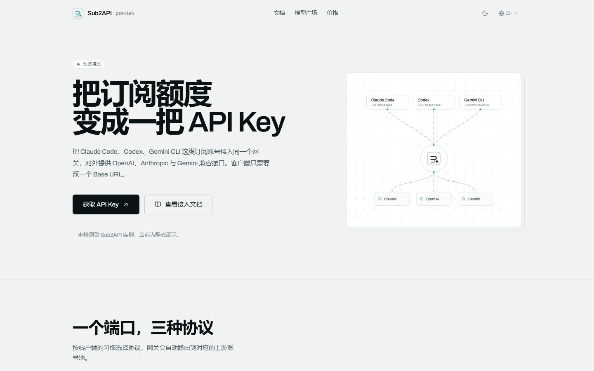
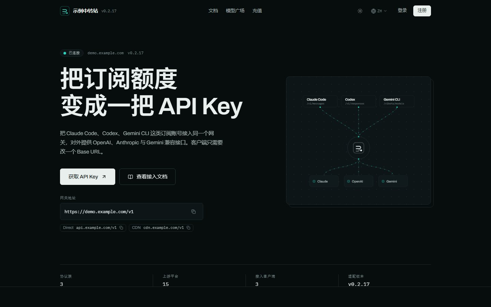
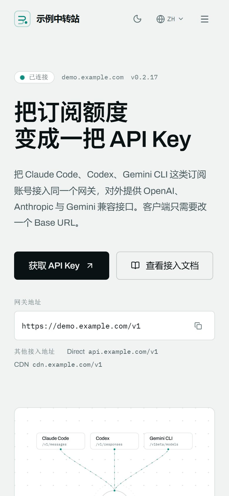
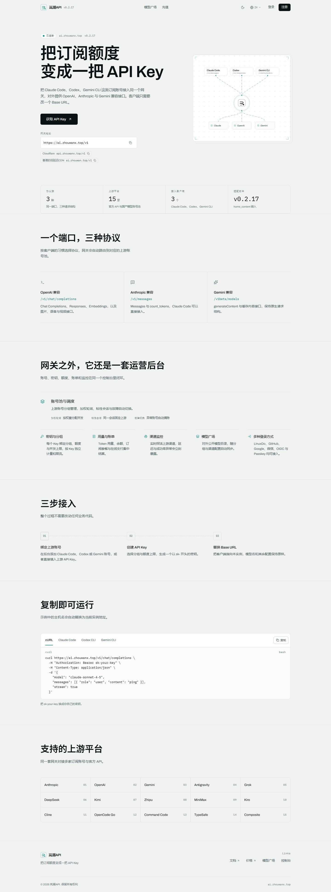

# sub2api-pages

> 一个可以直接部署到 Vercel 的 **Sub2API 自定义首页**，通过官方 `home_content` iframe 嵌入替换默认首页。

<p align="center">
  
</p>

<p align="center">
  <a href="https://vercel.com/new/clone?repository-url=https%3A%2F%2Fgithub.com%2FCanYanQwQ%2Fsub2api-pages"></a>
  
  
  
  
  <a href="LICENSE"></a>
</p>

---

## 目录

- [这是什么](#这是什么)
- [效果](#效果)
- [三步用起来](#三步用起来)
- [工作原理](#工作原理)
- [配置](#配置)
- [页面内容与 0.2.17 的对应关系](#页面内容与-0217-的对应关系)
- [设计约束](#设计约束)
- [技术栈与目录](#技术栈与目录)
- [字体子集](#字体子集)
- [本地开发](#本地开发)
- [常见问题](#常见问题)
- [验证清单](#验证清单)
- [许可证](#许可证)

---

## 这是什么

Sub2API 的后台设置里有一个 **「设置 → 站点 → 首页内容」**（字段名 `home_content`）。
当这个字段以 `http://` 或 `https://` 开头时，`HomeView.vue` 会把它当作 iframe 的 `src`
**整页渲染**——父站的顶栏和页脚都不再出现，访客看到的就是你的页面。

这个仓库就是那个「被嵌入的页面」：一个纯静态、零后端、可零配置接入的现代化首页。

它**不是**一个通用模板站。页面上的每一句话都对应 Sub2API 0.2.17 的真实能力，
链接会指向你自己的实例，版本号会读你实例的真实版本。

---

## 效果

### 深色主题

<p align="center">
  
</p>

### 移动端

<p align="center">
  
</p>

### 整页

<p align="center">
  
</p>

---

## 三步用起来

### 1. 部署

```bash
git clone https://github.com/CanYanQwQ/sub2api-pages.git
cd sub2api-pages
npm ci
npm run build     # 产物在 dist/
```

推到 Vercel：

```bash
npm i -g vercel
vercel --prod
```

或者在 Vercel 里 **Import Project** 选这个仓库——`vercel.json` 已经声明好构建配置，
Framework 会自动识别为 Vite，不需要改任何设置。

部署完你会拿到一个形如 `https://your-home.vercel.app` 的域名。

> 也可以部署到任意静态托管（Cloudflare Pages、Netlify、Nginx）。
> `dist/` 是纯静态文件，没有服务端、没有运行时环境变量依赖。

### 2. 填进 Sub2API

用管理员账号登录 Sub2API：

**设置 → 站点 → 首页内容** → 填入你的部署地址 → 保存。

```
https://your-home.vercel.app
```

打开首页，整页就是这个模板了。

### 3. 收工

就这样。**不需要改 CSP，不需要加白名单，不需要重启服务。**

原因见下一节。

---

## 工作原理

### 为什么不用改父站 CSP

`backend/internal/service/setting_public.go` 里的 `GetFrameSrcOrigins()` 会自动从
`home_content` 中解析出 origin，并注入父站 CSP 的 `frame-src`。所以只要 URL 填对，
父站就允许嵌入。

### 为什么父站的 `X-Frame-Options: DENY` 不影响它

那个响应头只作用于**父站自己的文档**，不会传给 iframe 里的子页面。
本项目本身**不发送** `X-Frame-Options` 和 `frame-ancestors`，所以可以被嵌入。

`vercel.json` 里只设了三个安全的头（`X-Content-Type-Options`、`Referrer-Policy`、
`X-DNS-Prefetch-Control`），刻意没有设任何禁止嵌入的头。

### 实例地址是怎么自动找到的

页面在 iframe 里运行，会按下面的顺序确定「Sub2API 实例在哪」：

| 优先级 | 来源 | 说明 |
| --- | --- | --- |
| 1 | `?api=https://你的实例` | URL 参数，显式覆盖 |
| 2 | `VITE_SUB2API_BASE_URL` | 构建期环境变量 |
| 3 | `document.referrer` 的 origin | **嵌入时自动生效，通常无需任何配置** |

第 3 条是关键：父站带 `Referrer-Policy: strict-origin-when-cross-origin`，会把父页面的
origin 传进 iframe。于是页面能自己推导出实例地址——「复制网关地址」、登录/注册、
模型广场等链接全部指向正确的实例，**零配置**。

### 三种连接状态

页面上的细线状态提示会显示当前状态：

| 状态 | 触发条件 | 表现 |
| --- | --- | --- |
| **已连接** | 成功读到 `/api/v1/settings/public` | 站点名、Logo、版本号、开关项全部用实例真实值 |
| **已识别实例** | 知道实例地址，但公开设置被 CORS 拦截 | 文案用内置版本，链接仍然正确 |
| **预览模式** | 完全没检测到实例 | 纯静态展示（本地开发时的默认状态） |

想让它停在「已连接」，把本页面的 origin 加进 Sub2API 的 `cors.allowed_origins`：

```yaml
# config.yaml
cors:
  allowed_origins:
    - https://your-home.vercel.app
```

**这是可选的。** 不加也能正常用，只是文案走内置版本。

### 站点 Logo 是怎么来的

「已连接」时，左上角和页脚的品牌标记直接取实例的 `site_logo`，不需要在这里再传一次图。
三种返回值分别处理：

| 实例返回的 `site_logo` | 页面表现 |
| --- | --- |
| `data:image/...` | 直接内联渲染，不产生额外请求 |
| `/uploads/logo.webp` 这类相对路径 | 拼到上一步推导出的实例 origin 上 |
| 空值，或图片解码失败 | 退回内置几何标记，不会留下破图 |

0.2.17 的 `sanitizeUrl` 会把后台上传的图片转成 data URI 存进设置，所以实际遇到的
大多是第一种。徽标沿用 0.2.17 自己的渲染方式——固定方框 + `object-contain` + 约 22%
圆角——非正方形的图不会被拉伸，也不会撑破顶栏。

---

## 配置

### URL 参数

全部可选，直接拼在首页内容里即可。

| 参数 | 取值 | 作用 |
| --- | --- | --- |
| `?theme=` | `light` / `dark` / `auto` | 强制主题，并隐藏主题切换按钮 |
| `?lang=` | `zh` / `en` / `ja` | 强制语言，并隐藏语言切换按钮 |
| `?api=` | 实例 origin | 覆盖自动推导的实例地址 |
| `?live=0` | `0` | 关闭所有网络请求，纯静态渲染 |
| `?pricing=` | `auto` / `always` | 「充值」入口是否跟随实例的 `payment_enabled` |
| `?site=` | 任意文本 | 兜底站点名，冷启动首帧就用它，避免先显示通用名 |

例：

```
https://your-home.vercel.app/?theme=dark&lang=zh
```

**为什么主题要靠参数？** 跨域 iframe 读不到父站的主题设置和 localStorage。
所以走三级回退：`?theme=` → 自身 localStorage → `prefers-color-scheme`。

### 构建期环境变量

全部可选，见 [`.env.example`](.env.example)。这些值会被打进产物，运行时无法更改。

| 变量 | 说明 |
| --- | --- |
| `VITE_SUB2API_BASE_URL` | 实例 origin；一般不需要，referrer 已能推导 |
| `VITE_SITE_NAME` | 兜底站点名，会被实例的 `site_name` 覆盖 |
| `VITE_DOCS_URL` | 文档地址；0.2.17 没有 `/docs` 路由，留空则回退到仓库地址 |
| `VITE_REPO_URL` | 仓库地址，页脚「Build」栏展示 |
| `VITE_CONTACT_URL` | 联系方式地址 |
| `VITE_SHOW_PRICING` | `auto`（默认）跟随实例 `payment_enabled`；`always` 强制显示「充值」 |

---

## 加载策略：为什么刷新时不会再闪一下

首页内容是通过 `/api/v1/settings/public` 拿到站点名、版本号和导航开关的，这是一次网络往返。如果首帧直接渲染，就会先出现兜底文案，等数据到了再「变」成你的站点——这就是闪烁。三层处理：

1. **同步缓存**。每次成功读取后把 payload 存进 `localStorage`（按实例 origin 分键，7 天 TTL）。刷新时在 `useState` 初始化函数里同步读出来，首帧就是最终状态。
2. **请求提前**。`main.tsx` 在 `createRoot` 之前就发起请求，让网络往返与 React 首屏渲染重叠，而不是渲染完再发。
3. **三态门控**。依赖设置项的导航（「模型广场」「充值」）在数据未到时返回 `pending`：位置留着但不显示，所以既不会先冒出来再消失，也不会引起布局跳动。

代价只有一处：**从未访问过的设备首次打开**时还没有缓存可用，那一帧会短暂显示兜底站点名（约等于一次接口往返）。这是客户端取数的固有延迟。想连这一帧也消除，在首页内容地址里加上 `?site=你的站点名`。

---

## 页面内容与 0.2.17 的对应关系

页面上的每个说法都对应 0.2.17 的真实实现，不是通用宣传语：

| 页面模块 | 对应的 0.2.17 实现 |
| --- | --- |
| 三种协议：`/v1/chat/completions`、`/v1/messages`、`/v1beta/models` | OpenAI / Anthropic / Gemini 三个兼容入口 |
| 15 个上游平台 | `Anthropic`、`OpenAI`、`Gemini`、`Antigravity`、`Grok`、`DeepSeek`、`Kimi`、`Zhipu`、`MiniMax`、`Kiro`、`Cline`、`OpenCode Go`、`Command Code`、`TypeSafe`、`Composite` |
| 账号池与调度 / 密钥与分组 / 用量与账单 / 渠道监控 / 模型广场 / 多种登录方式 | 后台对应的六个功能区 |
| 三步接入 | 绑定上游账号 → 创建 API Key → 替换 Base URL |
| 模型目录（深色区块） | `GET /api/v1/model-plaza`，逐分组列出公开模型，并显示**该实例上的实际单价**（`models[].pricing.intervals`）。按 token 计价显示每百万 token 的输入 / 输出价；按次计价（图片 / 视频）显示每次价，并把 `tier_label` 里 1K / 2K / 4K 等分辨率档位逐档列出；长上下文分档（`≤272K` / `>272K`）行内显示首档并标「起」，完整分段在悬停提示中。分组的 `rate_multiplier` **每个分组都显示**（含 `×1`）；接口关闭或需登录时整块消失 |
| 其他接入地址 | `settings.custom_endpoints`，实例配置了几条就列几条；每条都是一枚可点击复制的 chip，复制内容与主地址一致（完整 URL），前面不加小标签。没有配置时不显示这一块 |
| 首屏规格条：3 / 15 / 3 / 版本号 | 协议族数、上游平台数、支持的 CLI 数、`settings.version`。三个计数都取自 `src/data/content.ts` 的 `PROTOCOLS` / `UPSTREAM_PLATFORMS` / `CLIENT_CLIS`，源码里没有裸数字；版本号在「已连接」时是实例真实值 |
| 页脚 `iframe / home_content` | 本页面自身的接入方式 |
| 页脚版本号 | 「已连接」时显示实例真实版本，否则显示 `0.2.17` |

---

## 设计约束

这个页面的视觉是刻意收敛的，不是随便挑的：

- **零渐变装饰。** 没有蓝紫渐变、没有渐变按钮、没有渐变文字。全站只有 1px 发丝线、
  留白和等宽字体标注来建立层次。（唯一的 `gradient` 用法是两个单色 mask，用来让
  点阵纹理和分隔线在边缘淡出，不产生任何彩色渐变。）
- **零表情符号。** 所有图形来自 [`lucide-react`](https://lucide.dev) 图标库或手写内联 SVG。
  右侧的网关拓扑图是纯 SVG，无位图。全站唯一的位图是**实例自己提供的 Logo**，且只在
  实例确实配置了图片、且解码成功时才出现。
- **零阴影、零玻璃拟态。** 层次靠边框和背景色差，不靠投影。
- **品牌色取自 Sub2API 自身的 teal**（`#14b8a6` 一系），与父站视觉连续。
- **中文标题按语义断行。** 「变成」「还是」这类词不会在中间折行。
- **字体全部自托管**：Archivo（拉丁展示）与 IBM Plex Mono（等宽标注）走 `@fontsource`，
  中文标题另用 Noto Sans SC 的子集（见下方「字体子集」），不依赖 Google Fonts CDN。
- **模型目录是唯一换底色的区块，但它不是第二套配色。** `.sheet-invert` 只是把同一组
  设计令牌在区块内重新赋值，所以 `bg-canvas`、`text-ink-2`、`border-line` 这些工具类
  在区块内外都成立，深色主题下它会朝相反方向提亮，仍然读作「一个区块」。
- **动效只有一种语法：入场。** 每个区块用同一个 `IntersectionObserver` 在进入视口时
  上浮淡入，首屏规格条的数字在落位时累加一次（`useReveal` / `useCountUp`，  `src/lib/motion.ts`）。没有视差、没有循环动画、没有 hover 位移。
  所有动画都在 `prefers-reduced-motion` 下失效，且 `html.reveal-on` 只在脚本执行后才加，
  所以脚本没跑起来时页面是完整可见的，不会变成一排隐形区块。
- **密度靠删掉容器，不是靠缩小字号。** 区块间距比常规落地页紧一档（`py-14 sm:py-16 lg:py-20`），腾出来的空间给了内容：能力区从六张等大卡片改成「一个主条目 + 五个支撑条目」，上游平台从卡片改成一张三列规则表。
- **价格不折叠。** 分档计价（1K / 2K / 4K、长上下文）逐档摊开，而不是只显示一个「$0.15 起」：读者要判断的是「我这张图多少钱」，一个数字答不了。唯一的例外是长上下文的两档 token 价——首档标「起」、完整分段放进 `title`，因为把每行都写成两个价格会把列表高度翻倍去描述少数请求。

---

## 技术栈与目录

- **React 19 + TypeScript + Vite 8** — 纯静态，无服务端
- **Tailwind CSS v4** — 主题通过 CSS 变量（`data-theme`）切换，不依赖 `dark:` 变体
- **lucide-react** — 图标库
- **零运行时依赖** — 没有状态库、没有路由库、没有 UI 框架

```
src/
  App.tsx                    页面骨架与实例状态机
  index.css                  设计令牌（浅色 / 深色两套 CSS 变量）
  components/
    InstanceContext.ts       实例状态类型
    ThemeContext.tsx         主题解析与切换
    layout/                  TopBar、Footer
    sections/                Hero、Protocols、Capabilities、Flow、
                             QuickStart、Upstreams、CallToAction、RoutingSchematic
    ui/                      Button、CopyField、StatusDot、Layout 等
  data/content.ts            上游平台等静态数据
  lib/                       config（URL 参数）、instance（实例探测与链接）、theme
  i18n/                      zh / en / ja 三套文案
public/
  fonts/                     中文展示字体子集与 OFL 授权
scripts/
  subset-font.py             重新生成上面那个子集
docs/                        README 截图
```

产物大小：JS gzip **约 88 kB**，全站含自托管字体 **约 725 KB**（其中中文子集 **87 kB**）。

### 字体子集

中文标题如果直接用系统字体（PingFang SC / 微软雅黑），笔画细节取决于访客的设备，而微软雅黑在 Windows 上字面偏大、字距偏紧，同一套版式在两台机器上会读出不同的「重量」。所以标题层额外用 **Noto Sans SC SemiBold** 的子集。

完整的 Noto Sans SC 可变字体是 **17.7 MB**，不可能随页面发货。构建期按页面真实用到的字裁剪：

```bash
python scripts/subset-font.py   # 需要 fonttools 与 brotli
```

脚本从 `src/` 与 `index.html` 里收集所有落在 CJK 区段内的字符（当前 **446 个**），用 `pyftsubset` 裁出 `wght=600` 的静态字重，再压成 woff2，产物 **87 KB**。

分工靠 `unicode-range`：CJK 码位走这个子集，其余字符仍由 Archivo 或系统字体渲染。因此：

- 只作用于标题（`h1` / `h2`），正文与 UI 文本不换字体，避免整站字重变厚；
- **改中文文案后要重跑一次脚本**，否则新增的字会退回系统字体——不会报错，只是字重不一致；
- 授权是 SIL Open Font License 1.1，全文见 [`public/fonts/OFL.txt`](public/fonts/OFL.txt)。

---

## 本地开发

```bash
npm ci
npm run dev        # http://localhost:5173
npm run typecheck  # 只做类型检查
npm run build      # 类型检查 + 生产构建
npm run preview    # 预览 dist/
```

本地直接打开是「预览模式」（没有父站 referrer）。

想模拟被嵌入的效果，用一个不同端口的静态服务器当父站：

```html
<!-- parent.html -->
<iframe src="http://localhost:5173/" style="width:100vw;height:100vh;border:0"></iframe>
```

```bash
npx serve . -l 5000   # 然后访问 http://localhost:5000/parent.html
```

这样 `document.referrer` 会变成 `http://localhost:5000/`，页面进入「已识别实例」状态。

---

## 常见问题

<details>
<summary><b>首页是一片空白 / 被浏览器拦住了</b></summary>

检查「首页内容」填的是不是完整的 `https://` 地址。父站的 CSP `frame-src`
依赖这个 URL 的 origin，填相对路径或不带协议会被当成 HTML 内容而不是 iframe。

</details>

<details>
<summary><b>顶部导航里没有「充值」</b></summary>

入口是否显示只看一个开关：`payment_enabled`。这和 0.2.17 完全一致 ——
侧边栏里 `/purchase` 声明的是 `featureFlag: flagPayment`，而
`utils/featureFlags.ts` 把 `payment` 定义为 `{ key: 'payment_enabled', mode: 'opt-out' }`，
`/purchase` 路由守卫 `requiresPayment` 也只用同一个判断。所以只有实例**显式关闭支付**
（`payment_enabled: false`）时入口才会消失，否则点进去会被弹回 `/dashboard`。

注意 `purchase_subscription_enabled` **不参与判断**。后端把它注释成「是否展示购买订阅页面入口」，
但 0.2.17 前端没有任何模块读它（只在一个测试用例里当 fixture 出现），拿它做门控会让
支付正常开启的实例也丢掉入口。

想让它常驻，不管实例设置：在首页内容里加 `?pricing=always`（构建期可用 `VITE_SHOW_PRICING=always`）。

</details>

<details>
<summary><b>刷新时先闪一下默认内容，然后才变成我的站点</b></summary>

以前是因为设置接口在首帧之后才发请求。现在做了同步缓存 + 预取 + 三态门控，刷新时
首帧即最终状态（见 [加载策略](#加载策略为什么刷新时不会再闪一下)）。

如果换一台从未访问过的设备仍能看到短促的兜底文案，那是没有缓存可用，属客户端取数
的固有延迟；在首页内容里加 `?site=你的站点名` 可以让那一帧也直接正确。

</details>

<details>
<summary><b>状态显示「已识别实例」而不是「已连接」</b></summary>

说明公开设置接口被 CORS 拦了。把 Vercel 域名加进 `cors.allowed_origins` 即可
（见 [工作原理](#工作原理)）。不处理也能用，只是文案走内置版本。

</details>

<details>
<summary><b>主题跟父站不一致</b></summary>

跨域 iframe 读不到父站主题。在首页内容里加 `?theme=dark` 强制深色，
或者保持 `auto` 让页面跟随访客的操作系统。

</details>

<details>
<summary><b>能改成自己的品牌吗</b></summary>

可以。品牌名、文案集中在 `src/i18n/`，配色集中在 `src/index.css` 的 CSS 变量里。
改配色只需改 `--c-brand` 一系的几个变量，深浅色两套都会跟着变。

</details>

<details>
<summary><b>升级 Sub2API 版本后要改什么</b></summary>

如果新版本改了 `home_content` 的语义（目前没有），需要同步调整。上游平台列表
和协议路径在 `src/data/content.ts` 和 `src/i18n/` 里，跟着改文案即可。

</details>

---

## 验证清单

- [x] `npm run typecheck` 零错误
- [x] `npm run build` 通过
- [x] 跨域 iframe 内渲染正常，`document.referrer` 自动推导实例地址
- [x] 公开设置被 CORS 拦截时优雅降级，无未捕获异常
- [x] 1440 / 834 / 390 三档视口布局正确
- [x] 浅色与深色主题均通过对比度检查
- [x] 不发送 `X-Frame-Options` / `frame-ancestors`，可被父站嵌入
- [x] Logo 四种来源（data URI / 相对路径 / 空值 / 解码失败）表现正确，失败时无破图
- [x] 全量扫描确认无表情符号、无彩色渐变

---

## 许可证

[MIT](LICENSE)。

Sub2API 本身是另一个项目，遵循其仓库
[Wei-Shaw/sub2api](https://github.com/Wei-Shaw/sub2api) 的许可证。
