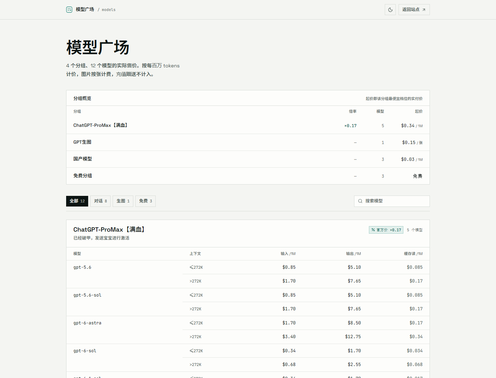
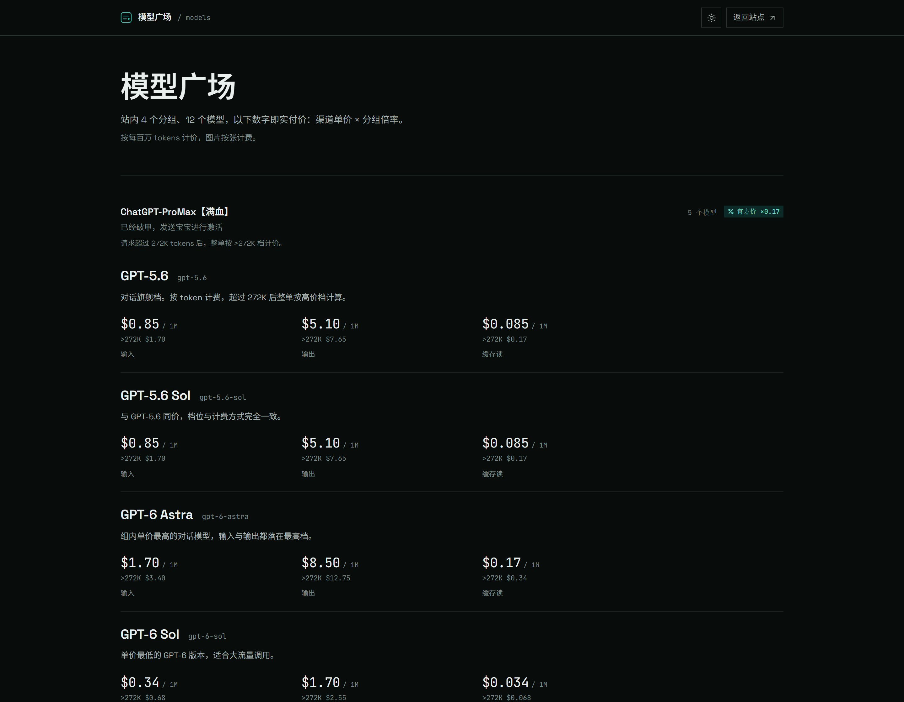
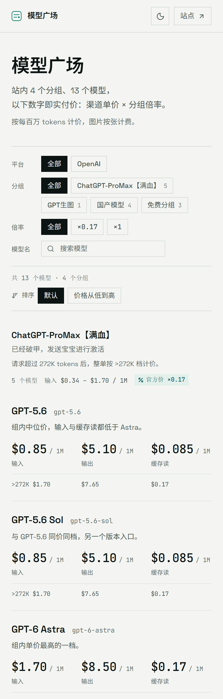
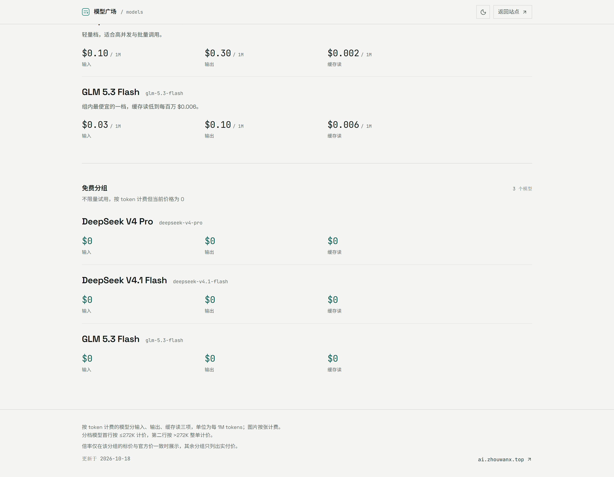

# 模型广场 · 独立页面

Sub2API 站的模型价目表。**价格全部硬编码在 `src/data/catalog.ts`**，不请求任何接口。



| 深色主题 | 移动端 |
| --- | --- |
|  |  |

## 为什么硬编码

官方 `/model-plaza` 只有一个开关 `model_plaza_enabled`：关掉它就同时关掉入口和接口
（`backend/internal/handler/model_plaza_handler.go` 里 `!rt.Enabled` 直接 404），
而匿名可用的公开接口只有 `GET /api/v1/settings/public`，里面不含分组与价格。
所以想换掉广场的外观，数据只能写死；代价是**改价要改文件、重新部署**。

计价公式照抄 0.2.17 前端（`PlazaModelPricingTable.vue`）：
实付价 = 渠道单价 × 分组倍率，token 类再乘 1e6 换算成「每百万 tokens」；
官方价不乘倍率，所以这个页面只显示实付价，不并列官方价。

## 版式

页面分三层，自上而下：

**一、分面筛选**，照 0.2.17 的 `PlazaFilterBar.vue` 复刻四行——平台 / 分组 / 倍率 / 模型名，
每行左侧一个 11px 小标签、右侧一排 chip。官方用圆角 + 蓝色渐变 + 阴影，这里按本页的令牌
改成直角发丝线 chip，选中态是实心墨色。分面联动置灰也照抄：当前组合下没有结果的那个
选项置灰不可点（`src/lib/filters.ts` 的 `platformEnabled` / `groupEnabled` / `rateEnabled`），
「全部」永远可点。本实例四个分组都在 `openai` 下，平台行仍保留——四行是官方广场的形状。

筛选条下面一行工具栏：左边「共 N 个模型 · M 个分组」（有筛选时变成「筛出 N 个」+ 清除），
右边是排序开关「默认 / 价格从低到高」。按价格排序时**分组也跟着重排**（免费 → 对话 → 生图，
同类型内按组内最低价升序）——只排组内模型的话，一个 $0.03 的模型会留在 $1.70 的模型下面，
整页看起来仍然没排。

**二、分组与模型**。分组是唯一的层级：一条 `border-t` 发丝线 + 组名 + 说明，
右侧是「N 个模型 · 价格区间 · 倍率徽章」。区间只报入口档（token 类的输入价、生图的每张价），
并显式写出「输入」/「每张」，避免被读成输出价或混合价。

组头在 `sm` 以上吸顶（`sm:sticky sm:top-14`）：一页三千多像素，滚到中段时唯一值得一直
挂着的信息就是「这是哪个分组」。手机上组头说明会换行到 100px 以上，吸住会吃掉视口，
所以小屏让它正常滚走。

组内每个模型一个横区块：模型名（展示名 + mono slug）→ 一行说明 → 价格。

**三、价格**。固定三列（输入 / 输出 / 缓存读；生图是 1K/2K/4K 三个档位），
数字用等宽字体、**比模型名更大**（26px vs 17px）——一页十几个模型，读者是来比价的，
数字当主角、名字当注脚。三列共用一个 `grid`，所以每一列的标签、第二行数字在整页所有
区块里都落在同一条基线上，视线可以笔直往下扫。三列总宽限制在 832px：铺满容器的
话每列之间会空出 300px 以上，读不成一行。

分档模型（`long_context_pricing_enabled`）把 `>272K` 档放进**独立的一行**，而不是塞进
单个数字下面：塞进去会让那一列的标签被顶下去，三列标签就错位了。这一行的档位标记只印一次。

中文段落用了 `break-keep`：默认的中文断行会把「每百万」拆成「每百 / 万」两行。

分组的尾部（含生图、免费分组与页脚口径说明）：



## 改价

只改 `src/data/catalog.ts` 里的 `GROUPS`。每个模型的价格填**渠道单价**（美元 / token，
如 `5e-6`），不要填乘过倍率的结果——渲染时统一乘 `rateMultiplier`。
生图模型填 `perImage`（每张的渠道单价），倍率同样由分组带。

`rateVerified` 是「这个分组的标价是否等于官方价」的人工结论，只有为 `true` 时页面才
显示倍率徽章（此时标价 × 倍率就是实付价，倍率有解释力）。若某分组的标价本身就偏离
官方价，倍率乘出来会误导，就置 `false`，页面只列实付价。

`label` 是给人看的名字（`GPT-5.6`），`name` 是要粘进代码的 slug（`gpt-5.6`），
`note` 是那句中文说明。新增分组时若模型分档，`tiers` 按顺序给两档，`label` 写
`≤272K` / `>272K`。

分组的 `kind` 决定价格区怎么排：`chat` = 输入/输出/缓存读三列，`image` = 每个档位一列
（`perImage`），`free` = 三列 `$0`（保留相同的行节奏，不用一个宽格写「免费」）。
`platform` 填上游平台 id（`openai` / `anthropic` / `gemini` …），平台筛选行按它分组，
展示名在 `src/components/FilterBar.tsx` 的 `PLATFORM_LABELS` 里映射。

新增分组或模型后要重跑 `npm run fonts`（页面上会出现新的汉字）。

## 本地开发

```bash
npm ci
npm run dev        # http://127.0.0.1:5173
npm run build      # tsc --noEmit && vite build
npm run preview    # 预览构建产物
```

## 部署到 Vercel

本仓库根目录就是项目根目录。导入后按下表设置即可：

| 项 | 值 |
| --- | --- |
| Framework Preset | Vite |
| Root Directory | `./`（默认；从 `sub2api-pages` 仓库导入时填 `plaza`） |
| Build Command | `npm run build`（即 `tsc --noEmit && vite build`） |
| Output Directory | `dist` |
| Install Command | `npm ci`（`package-lock.json` 已在仓库里） |

构建产物是纯静态文件，无需任何环境变量。这份代码同时存在于两个仓库：独立仓库
[`CanYanQwQ/models`](https://github.com/CanYanQwQ/models) 与
[`CanYanQwQ/sub2api-pages`](https://github.com/CanYanQwQ/sub2api-pages) 的 `plaza/` 子目录，
改价时只改一处，别两边各改一遍。

## 接进 Sub2API

后台「系统设置 → 自定义菜单」新增一项，URL 填这个页面部署后的地址。点开时
`CustomPageView.vue` 会用 iframe 加载它，并自动带上 `theme` / `lang` 等参数。

页面里所有跳回主站的链接都是 `target="_top"`，会跳出 iframe 整页跳转；主站地址从
`document.referrer` 的 origin 推导（iframe 由主站同源页面发起，所以能拿到），
推导失败时回退到 `src/lib/site.ts` 里的常量。

主题优先级：`?theme=` → `localStorage['sub2api-plaza:theme']` → `prefers-color-scheme`，
在 `index.html` 的首屏内联脚本里就定下来，不会闪。

## 字体

- 拉丁与数字：`@fontsource-variable/space-grotesk`、`@fontsource-variable/jetbrains-mono`，
  随构建打包，不依赖任何 CDN。
- 中文：Noto Sans SC 子集，两个字重各一个文件——`public/fonts/noto-sans-sc-plaza-400.woff2`
  （25.6 kB，正文）与 `-600.woff2`（26.0 kB，标题）。只保留页面实际用到的 185 个字
  （渲染后核对：页面出现的 167 个汉字全部命中，无回退）。许可证见 `public/fonts/OFL.txt`
  （SIL OFL 1.1）。

两个 `@font-face` 声明同一个 family、不同 `font-weight`，`unicode-range` 限制在 CJK 区段，
拉丁字符仍然走 Space Grotesk。只声明一个 600 会让所有中文正文都渲染成半粗，和西文 400
正文对不齐。

改完中文文案后要重跑子集，否则新字会掉回系统字体：

```bash
pip install fonttools brotli
npm run fonts            # 读 src/ 与 index.html，重写 public/fonts/*.woff2
```

## 设计约束

纸 + 墨 + 单一 teal 强调色；分隔只用发丝线，**全站零渐变、零阴影、零 emoji**；
图标一律来自 `lucide-react`，示意图形用手写内联 SVG。深色主题只换令牌，不换版式。
